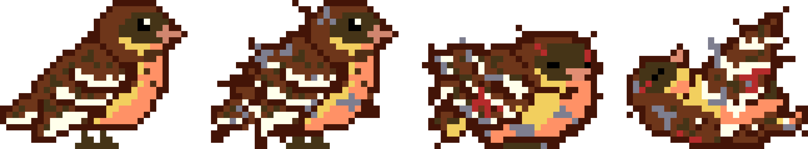
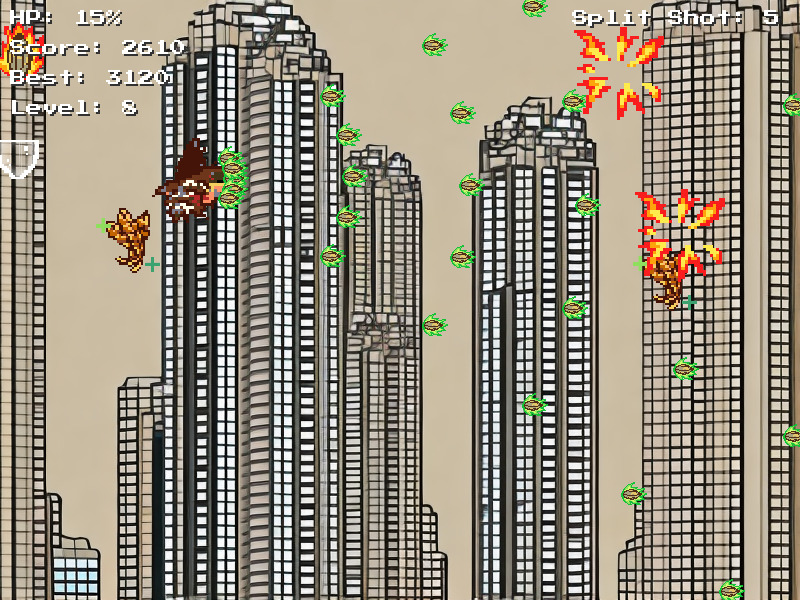
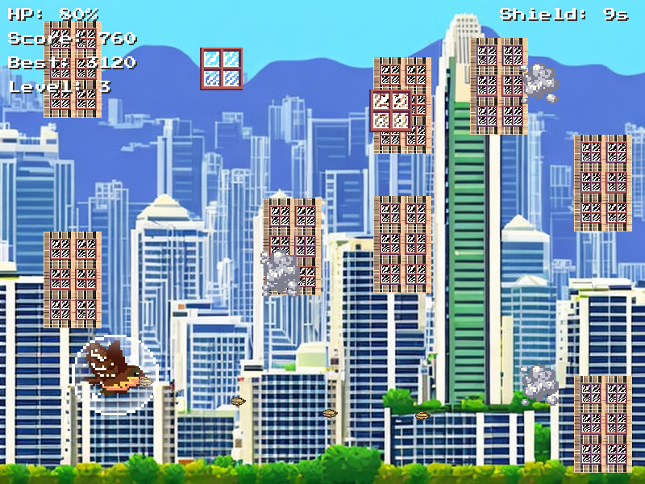
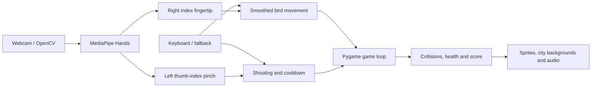

# Bird in the City

**A gesture-controlled pixel-art game about a bird's journey through the city.**

Guide a yellow-breasted bunting through an urban landscape using your webcam: move with your right hand and pinch with your left to shoot. Glass, smog, and high-rise buildings become obstacles, while the bird and the city change appearance as health falls.

<p align="center">
  
</p>

<p align="center">
  <a href="https://www.youtube.com/watch?v=oaUomb2fTL8"><strong>Watch the demo ↗</strong></a> ·
  <a href="#quick-start">Run locally</a> ·
  <a href="docs/README.zh-CN.md">中文说明</a> ·
  <a href="docs/ARCHITECTURE.md">Code guide</a>
</p>

## The idea

What does a city feel like from a bird's perspective? **Bird in the City** turns that question into a small environmental-awareness game. Its story follows a yellow-breasted bunting displaced from its habitat and travelling through Hong Kong's cityscape.

The interaction connects physical movement to survival: one hand guides the bird, the other fires at incoming threats. Damage is visible in both the character and its surroundings, making health part of the visual narrative rather than just a number in the corner.

This repository contains a **local Python game prototype**, its artwork, fonts, and sound effects. It uses MediaPipe's pretrained hand tracking; it does not train a custom recognition model. The environmental theme is a design intention, not a claim of measured educational impact.

## A city that changes with you


| Healthy · 75–100 HP | Hurt · 25–74 HP | Critical · below 25 HP |
| :--- | :--- | :--- |
| A bright skyline and an intact bird. | A muted city and a visibly injured bird. | A grey city and a heavily damaged bird. |

<p align="center">
  
</p>

The background is selected by the bird's current health. Collecting a recovery item can restore an earlier visual state; this is a game feedback system, not an environmental simulation.

## Inside the game

<table>
  <tr>
    <td width="50%"></td>
    <td width="50%"></td>
  </tr>
  <tr>
    <td><strong>Fly through urban hazards.</strong> Avoid glass, smog, and high-rise enemies while shooting and collecting power-ups.</td>
    <td><strong>See the cost of damage.</strong> Character sprites and city backgrounds respond to remaining health.</td>
  </tr>
</table>

<details>
<summary>See the shield power-up</summary>



</details>

*Presentation note: gameplay images were supplied with the project's portfolio assets. They were rendered from game code with simulated gesture input and staged HUD values; they are illustrative screenshots, not live playtest captures. See [image provenance](docs/images/README.md).*

- **Keyboard fallback:** WASD / arrow keys to move, Space to shoot; automatic fallback when the camera fails.
- **Two-hand control:** right index fingertip for movement; left thumb–index pinch for shooting.
- **Five power-ups:** health recovery, shield, rapid fire, triple shot, and spread shot.
- **Progression:** scores, combo bonuses, rising levels, and increasingly frequent enemies.
- **Audiovisual feedback:** animated bird states, impact and recovery effects, background music, and sound effects.
- **Local high score:** the best score is saved between sessions.

## How to play

For gesture control, keep both hands visible to the webcam with enough light and space around them. Keyboard controls are available without a camera. On keyboards with media-function keys, you may need to hold Fn while pressing F2 or F3.

| Action | Control |
| :--- | :--- |
| Start / read the story / quit | Click **PLAY**, **INTRO**, or **QUIT** on the menu |
| Move the bird | Move your **right index fingertip**; flight is constrained to the left third of the game window |
| Shoot | Pinch your **left thumb and index finger** together; holding the pinch repeats shots after a cooldown |
| Restart after game over | Press **R** with the game window focused |
| Quit after game over | Press **Q** with the game window focused |
| Keyboard movement / shooting | **WASD** or **arrow keys** / hold **Space** |
| Switch to keyboard | **F2** |
| Retry / switch to camera | **F3** |
| Exit | **Esc** or close the game window |

The game also opens a **Hand Tracking** window showing the camera feed and detected landmarks. Hand positions are processed locally by the current implementation.

## Quick start

Use **Python 3.11 or 3.12** and a desktop session with working graphics and audio. A webcam is needed only for gesture control. Installation and automated gameplay checks were verified on macOS ARM64 with Python 3.12; other platforms still need testing.

```bash
git clone https://github.com/092135/bird-in-the-city.git
cd bird-in-the-city
python3.11 -m venv .venv
```

Activate the environment:

```bash
# macOS / Linux
source .venv/bin/activate

# Windows PowerShell
.venv\Scripts\Activate.ps1
```

Then install and launch:

```bash
python -m pip install -r requirements.txt
python run.py

# Start without opening a camera
python run.py --input keyboard

# Select a different camera
python run.py --input camera --camera-index 1
```

On Windows, use `py -3.11 -m venv .venv` to create the environment. Allow camera access for the terminal or IDE you launch from when your operating system asks.

The root launcher selects the game's working directory so the existing font and audio paths resolve correctly. The original entry point also works with `cd main` followed by `python test.py`.

### Troubleshooting

| Symptom | What to check |
| :--- | :--- |
| Camera does not open or the bird will not move | Close other camera apps, check OS camera permissions, and confirm the default camera (index `0`) is available. The game switches to keyboard controls on camera errors. Use WASD / arrows and Space, then press F3 to retry the camera. |
| `mediapipe` has no attribute `solutions` | Use a fresh Python 3.11 environment and the supplied requirements. The code uses the legacy `mp.solutions.hands` API. |
| Font or audio files cannot be found | Launch with `python run.py` from the repository root, or run `test.py` from inside `main/`. |
| Audio initialization fails | Check that the desktop session has an available audio device. The prototype expects audio to initialize. |
| R / Q appears unresponsive | Those keys are handled after game over; focus the Pygame window rather than the camera preview. |

## Project structure

```text
bird-in-the-city/
├── README.md                 # Project overview and setup
├── run.py                    # Root-level launcher
├── requirements.txt          # Direct dependency versions
├── tests/                    # Input and gameplay regression checks
├── docs/
│   ├── README.zh-CN.md       # Chinese overview and instructions
│   ├── ARCHITECTURE.md       # Input pipeline and code map
│   └── images/               # README visuals and provenance
└── main/
    ├── test.py               # Game implementation (not a test suite)
    ├── controls.py           # Camera and keyboard input adapters
    ├── Animation/            # Bird sprites, backgrounds, effects and UI
    ├── font/                 # Pixel font
    ├── sfx/                  # Music and sound effects
    └── highscore.txt         # Local best-score data
```

## How it works



| Component | Role |
| :--- | :--- |
| Pygame | Window, rendering, game loop, collisions, and audio |
| OpenCV | Webcam capture, frame conversion, and tracking preview |
| MediaPipe Hands | Landmark detection and left/right hand classification |
| NumPy | Distance calculations for gestures and collisions |

See the [code guide](docs/ARCHITECTURE.md) for implementation details and next steps.

## Prototype status

Camera and keyboard input live in `main/controls.py`; configuration, menus, gameplay, and rendering remain in `main/test.py`. Camera initialization and frame-processing errors switch to keyboard controls, with an on-screen mode hint. F2 selects keyboard control; F3 retries the camera.

Run the automated checks from the repository root:

```bash
python -m unittest discover -s tests -v
```

The checks use dummy video/audio devices, real game assets, and simulated input or camera failures. They cover movement, shooting cooldown, input switching, resource cleanup, and rendering of menus, health states, shield, and game over. They do not replace a live-camera hand-gesture playtest or confirm real audio output. See [validation details](docs/VALIDATION.md).

Further work should focus on live interaction testing and camera tracking quality before a broader code refactor.
