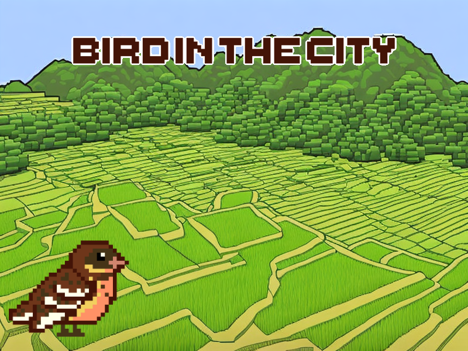
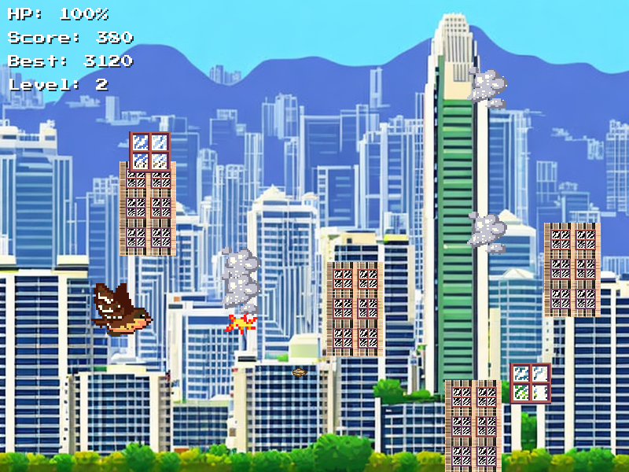

# Bird in the City · 城市中的鸟

**一个用双手手势控制、以城市生态为主题的像素风游戏原型。**

[English](../README.md) · [观看演示](https://www.youtube.com/watch?v=oaUomb2fTL8) · [代码结构](ARCHITECTURE.md)



## 这是什么项目？

玩家扮演一只失去栖息地、穿行于香港城市景观中的黄胸鹀。右手控制飞行，左手捏合射击，在玻璃、烟雾和高楼构成的障碍中生存，并收集恢复生命、护盾和射击强化道具。

这个项目尝试把城市环境对鸟类的压力转化成可以感知的游戏反馈：生命值下降时，小鸟的形态和城市背景一起变化。它是环境主题的交互原型；目前没有用户研究或教育效果数据来证明其实际影响。


| 生命值 | 视觉反馈 |
| :--- | :--- |
| 75–100 | 明亮的城市、健康的小鸟 |
| 25–74 | 色彩变暗的城市、受伤的小鸟 |
| 低于 25 | 灰色城市、重伤的小鸟 |

这些状态由当前生命值决定，回血后也会恢复，并非真实环境模拟。

## 怎么玩？

点击 PLAY 后，先选键盘／摄像头，再选弹药模式。开局前会显示当前模式的简短指导；点击 START 或按 Enter 后才刷怪。游戏中 H 可暂停查看指导，HOME 可回首页重新选模式，无需退出程序。

| 操作 | 方式 |
| :--- | :--- |
| 开始 / 查看故事 / 退出 | 鼠标点击菜单 PLAY / INTRO / QUIT |
| 移动 | 移动右手食指尖，小鸟活动范围限制在画面左侧三分之一 |
| 弹药模式 | 默认无限弹药，无需补弹；点击 PLAY 后选模式开始；开局后锁定，换模式需先回首页。有限模式弹夹 10 发，打空停止射击 |
| 射击 | 左手拇指与食指捏合；保持捏合会按冷却间隔连射 |
| 补弹（有限模式、少于 10 发时） | 左手五指张开保持半秒补满；收拢手指或丢失识别会中断补弹 |
| 游戏结束后重试 | 聚焦游戏窗口，按 R |
| 游戏结束后退出 | 聚焦游戏窗口，按 Q |
| 键盘移动 / 射击 | WASD 或方向键 / 按住空格 |
| 键盘补弹（有限模式、少于 10 发时） | 按住 E 半秒 |
| 打开 / 关闭操作指导（暂停游戏） | H 或点击 GUIDE |
| 开局前选择键盘 / 摄像头 | 模式页点击对应按钮，或按 K / C |
| 返回首页换模式 | 点击 HOME 或按 Esc；打开指导时 Esc 先关闭指导 |
| 退出 | 首页 QUIT、死亡后 Q，或关闭窗口 |

摄像头需要能看清双手，建议保持充分照明。额外打开的 Hand Tracking 窗口显示摄像头画面及手部关键点。当前代码在本机处理画面。



*截图来自项目已有的作品集素材，由游戏代码配合模拟手势输入渲染，分数和等级为展示用数值，不是实时试玩记录。详见[素材说明](images/README.md)。*

## 本地运行

Mac 朋友首次试玩，打开终端粘贴下面一行，会自动下载游戏、准备 Python 和依赖并启动：

```bash
/bin/bash -c "$(curl -fsSL https://raw.githubusercontent.com/092135/bird-in-the-city/main/scripts/install-macos.sh)"
```

首次需要联网下载较多依赖；以后双击 `~/Applications` 中的 `Bird in the City.command` 即可。详见[Mac 试玩说明](MAC_PLAYTEST.md)。

以下是开发者手动安装方式。

准备 Python 3.11 或 3.12，以及能正常使用图形界面和音频设备的电脑。手势模式需要摄像头，键盘模式不需要。

```bash
git clone https://github.com/092135/bird-in-the-city.git
cd bird-in-the-city
python3.11 -m venv .venv
source .venv/bin/activate
python -m pip install -r requirements.txt
python run.py

# 不打开摄像头，直接用键盘玩
python run.py --input keyboard
```

Windows 创建虚拟环境时使用 `py -3.11 -m venv .venv`，在 PowerShell 中用 `.venv\Scripts\Activate.ps1` 激活，然后运行相同的安装和启动命令。

新增的 `run.py` 会进入正确的资源目录再启动原程序，解决从项目根目录启动时字体、音效相对路径不正确的问题。原有的 `cd main` → `python test.py` 方式仍可使用。

已在 macOS ARM64 / Python 3.12 的独立环境中验证依赖安装，并使用真实资源、模拟输入和虚拟音视频设备运行自动化检查。真实摄像头手势试玩及声音播放仍需人工验证，详见[验证记录](VALIDATION.md)。

## 当前限制

- 摄像头打不开或中途读取失败会自动切换键盘，画面底部显示当前操作方式；回首页后可重新选择摄像头。
- 使用 `mp.solutions.hands` 旧接口，请在独立环境中安装指定依赖。
- 音频设备异常处理仍需完善；游戏目前期待音频设备可用。
- 输入控制已分离到 `main/controls.py`，配置、菜单、玩法和渲染仍保留在 `main/test.py`。

运行自动化检查：`python -m unittest discover -s tests -v`。

## 仓库导航

- [`../run.py`](../run.py)：从根目录启动游戏。
- [`../requirements.txt`](../requirements.txt)：依赖版本。
- [`../main/test.py`](../main/test.py)：游戏主体。
- [`../main/controls.py`](../main/controls.py)：摄像头、键盘输入与失败回退。
- `main/Animation/`、`main/font/`、`main/sfx/`：游戏美术、字体和声音。
- [`ARCHITECTURE.md`](ARCHITECTURE.md)：技术流程、主要类与后续拆分建议。
- [`images/`](images/)：README 展示素材。
